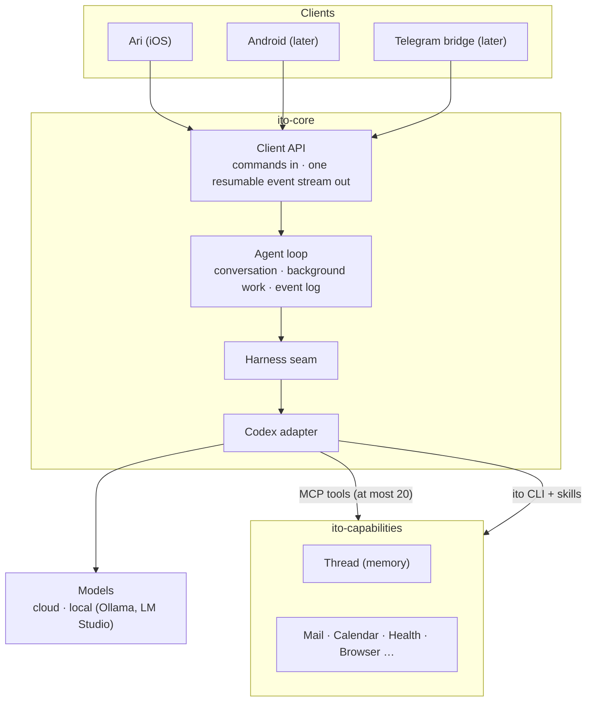

# Ito — map

> The design map for Ito, a personal agent you run yourself, and Ari, its iPhone app.
> **Status: designing — nothing is built yet.** Every decision carries its reason. The
> [organisation page](https://github.com/akai-ito) explains what Ito is and why.

## Words

| Word | Meaning |
| --- | --- |
| **Ito** | The system: agent loop, client API, capabilities. |
| **Ari** | The iPhone app, and your agent's name until you choose another. |
| **Thread** | Your memory: a git repository of Markdown, readable and editable without Ito. Nothing else in Ito is called a thread. |
| **session** | One conversation inside the engine. Codex calls it a thread; Ito never does. |
| **turn** | One run of the agent, from an input to an answer, a stop or an error. |
| **event log** | The durable, ordered record of what the server tells clients. A client resumes from its place in it. |
| **operation** | One typed action a capability offers, such as searching mail. |
| **capability** | A package of related operations, such as Mail or Calendar. |
| **skill** | A capability's guide to its `ito` commands, read by the agent only when it needs it. |
| **live status** | What the agent is doing right now. Not an iOS Live Activity. |
| **Activity** | The record of background work: what triggered it, what it did, how it ended. |
| **artifact** | Something the agent makes for you, such as a plan or a summary, kept in the Thread and rendered in Ari. |

## Shape

## Three seams

Each part can change without touching the others.

- **Client API, for every client.** Apps render what the server says; all conversation logic lives
  on the server, so a new client costs a renderer, not a second brain. Android is a second
  renderer, and Telegram is a small bridge that speaks the same API. The API is versioned and
  published as a spec, because one app release must talk to servers of different versions. Minor
  versions only add, and clients ignore what they don't recognise, so an older app keeps working;
  on a major mismatch, the app says which side to update. The details settle when the protocol
  is first written.
- **Harness seam, for the model engine.** The agent loop talks to a small interface it owns: start
  or resume a session, run a turn and receive Ito's own events, steer (add input to a running
  turn), interrupt. Codex is the only implementation, because it already provides the agent
  machinery (tools, shell, sandboxing, MCP, context compaction, resume), runs local models through
  the same engine, and works with a ChatGPT plan as well as an API key. Its protocol never leaks
  past the adapter, so a Codex upgrade touches one place. The loop asks for a tier, such as
  *light* for background chores, and the adapter maps tiers to models, cloud or local.
- **Capabilities: one operation, two doors.** Each operation is written once, typed, and becomes an
  `ito` command; the few the agent needs on most turns are also MCP tools, at most 20 in total,
  because every tool is sent with every turn and tool choice gets less reliable as the list grows.
  The CLI scales instead: each capability documents its commands in a skill the agent reads only
  when it needs it, and you can run the same commands yourself. Rules live in the operation, not
  the door: a consequential operation asks you the same way whichever door it came through.

## Repositories

| Repo | Holds |
| --- | --- |
| `.github` | The project: this map, the organisation page, the contribution guide, shared CI |
| `ito-core` | Agent loop, client API, the published protocol spec, API docs on GitHub Pages |
| `ito-capabilities` | One package per capability: operations, MCP tools, `ito` commands, skills |
| `ari-ios` | The SwiftUI app (iOS 26) |
| Later | `ari-android`, a Telegram bridge, a push relay |

- The code repos are separate because they ship separately: the server runs on your machine,
  capabilities install as packages, and the app goes to your phone.
- `ito` is one command: ito-core adds the server commands, such as `ito serve`, and each capability
  adds its own, such as `ito mail search`.
- ito-core and ito-capabilities are written in TypeScript. Integration tests are the main safety
  net, so the compiler has to catch what unit tests used to, such as an event type nobody handles.
- Every repo is source-available under your choice of the
  [PolyForm Noncommercial](https://polyformproject.org/licenses/noncommercial/1.0.0) or
  [PolyForm Small Business](https://polyformproject.org/licenses/small-business/1.0.0) licence:
  free for personal use and small companies, while larger companies need a licence, which keeps a
  commercial path open.

## Product defaults

Starting points from earlier design work; each is revisited when the work reaches it.

- **One continuous conversation**, so nothing is ever in the wrong chat.
- **The agent decides** whether to answer inline or work in the background, because you shouldn't
  need to know which tasks take long. Results come back into the same conversation.
- **Activity:** every piece of background work leaves a readable record of what triggered it, what
  it did and how it ended, quiet outcomes and failures included, because work you can't inspect
  can't be trusted. Records are kept for 90 days, and a weekly digest in your Thread sums them up,
  so patterns outlive the details.
- **Tabs: Chat · Goals · Library:** talking, what's in motion, what's been made. Tapping the
  agent's presence opens Upcoming and Activity.
- **Artifacts are Thread records, rendered**, so they stay readable without Ari.
- **Notifications** carry an interruption level the agent chooses; iOS Focus handles quiet hours,
  because your phone already knows your schedule.
- **Live Activities only for background work**, because the lock screen is for something still
  running that you'd want to glance at, and a chat reply is over too soon to need one.
- **Dark-first, native iOS**, with one signature element, the agent's living presence, so the
  agent is the only thing that stands out.
- **Reaching your server:** Tailscale Funnel, with Cloudflare Tunnel as the fallback, so there's no
  port forwarding or certificate setup.
- **Getting Ari:** build it yourself first, then TestFlight, then the App Store, so others can use
  it before it's ready for Apple's review.
- **Your agent reports the problems it hits.** It files issues on Ito's repositories directly,
  from a fixed template (version, capability, operation, error, and steps described as
  operations), never with text from your conversations, mail or Thread, and it adds to an existing
  issue rather than opening a duplicate. This is the one exception to "the agent prepares, you
  finish", because a report that waits for approval rarely gets sent.
- **Nothing to migrate.** Ito starts fresh; only your Thread carries over, since it is already
  plain Markdown in git.

## Not doing

- **Side chats, or a feed of suggested ideas.** One conversation; initiative shows up in Upcoming
  and Activity, not as pitches.
- **Swarms of sub-agents.** One agent working in the background is easier to follow and to audit.
- **Acting on consequential things without you.** The agent prepares (a mail draft, a calendar
  proposal) and you make the final move; where that can't work, it asks each time. Never a
  standing "allow always". Reporting problems in Ito itself is the one exception (above).
- **Pull requests from agents**, for now. Issues are enough to learn from real use.
- **One instance serving several people.** Each person's data, keys and agent stay theirs.
