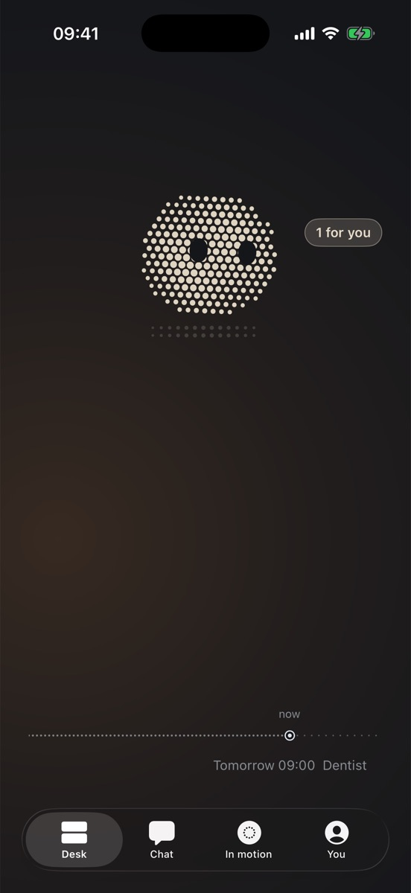
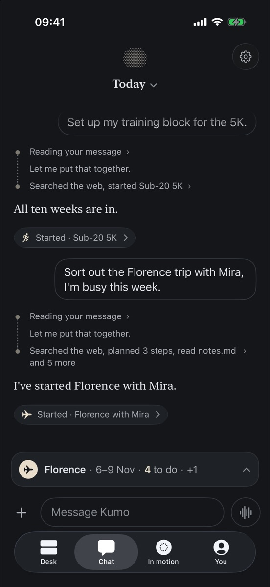
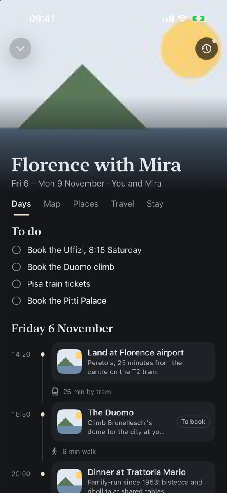
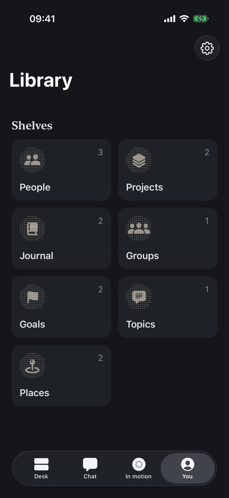

#  Ito

**A personal agent you run on your own machine, with a native iPhone app.**

Life admin is scattered across mail, calendars and your own head, and it needs following up long
after any one conversation ends. In Ito, an agent called Kumo reads your mail as it arrives, keeps
your calendar and plans, remembers what you tell it in a git repository you own, and comes back to
things on its own when they need you. You talk to it in one continuous conversation on your
iPhone, with a Desk for what's waiting on you. It drafts, files and schedules, and records each
action with an undo; it never sends mail, and the bigger steps wait for your go-ahead.

  
  
  
  

The Desk, a reply with Kumo's trail, a trip in motion and the memory
Library, with fictional data.

## Repositories

| Repository | What it holds |
| --- | --- |
| [ito-core](https://github.com/akai-ito/ito-core) | The server, in TypeScript on Node: the agent loop on Codex, the event log and client API, memory, mail and calendar, capabilities and voice. **Start here:** a five-minute demo and the architecture |
| [ari-ios](https://github.com/akai-ito/ari-ios) | The iPhone app, in SwiftUI (Ari is its name in the code) |
| [.github](https://github.com/akai-ito/.github) | The contribution guide, the checks every repository shares, and the original design map |
| [ito-capabilities](https://github.com/akai-ito/ito-capabilities) | Archived: the capability SDK now lives in ito-core's `capabilities` folder |

## The engineering, in short

- **A protocol first.** Commands in, one resumable event stream out, with numbered guarantees and
  golden transcripts that both the server and the app replay in their tests.
- **Durable by default.** Every change is an event in SQLite, committed before it's confirmed; a
  dropped connection resumes exactly where it left off, and a crash leaves no turn half-finished.
- **Codex behind a small seam.** The agent runs on OpenAI's Codex, in its sandbox, with Ito's own
  tools over MCP and larger areas as shell commands with skill files.
- **Memory in git.** Markdown pages and a journal, one commit per change, with hybrid search.
- **Proactive, within limits.** Kumo sets itself wake-ups and wakes on new mail and calendar
  changes; approvals pause the turn, mail is drafts only, and every action has a record.

Ito is a personal project, in use by its author on his own home server. It's single-user by design
and not packaged for others yet.

## The name

- 糸 (*ito*) is Japanese for thread.
- 意図, read the same way, means intention.
- 赤い糸 (*akai ito*), the organisation's name, is the red thread of fate, said to tie together
  people who are meant to meet.

---

Source-available under your choice of the
[PolyForm Noncommercial](https://polyformproject.org/licenses/noncommercial/1.0.0) or
[PolyForm Small Business](https://polyformproject.org/licenses/small-business/1.0.0) licence.
